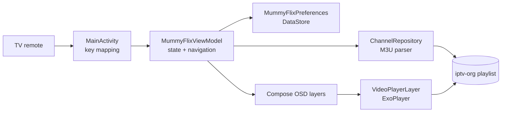

# MummyFlix

**A retro set-top-box style IPTV player for Android TV and Amazon Fire TV Stick.**

MummyFlix recreates the look and feel of a classic satellite receiver — cyan OSD panels, a scrolling channel list, a signal meter, an auto-scan screen and even a built-in Snake game — while playing real HLS streams with Media3 / ExoPlayer.

[](https://github.com/s4nch1tt/MummyFlix/actions/workflows/build.yml)
[](https://github.com/s4nch1tt/MummyFlix/releases/latest)
[](https://github.com/s4nch1tt/MummyFlix/releases)
[](https://github.com/s4nch1tt/MummyFlix)
[-blue)](https://github.com/s4nch1tt/MummyFlix)

---

## Table of contents

- [Overview](#overview)
- [Features](#features)
- [Screens and remote controls](#screens-and-remote-controls)
- [Menu reference](#menu-reference)
- [Requirements](#requirements)
- [Install on a TV or Fire TV Stick](#install-on-a-tv-or-fire-tv-stick)
- [Playlist and channels](#playlist-and-channels)
- [Build from source](#build-from-source)
- [CI/CD and automatic releases](#cicd-and-automatic-releases)
- [Versioning and commit conventions](#versioning-and-commit-conventions)
- [Project structure](#project-structure)
- [Architecture](#architecture)
- [Tech stack](#tech-stack)
- [Data and privacy](#data-and-privacy)
- [Known limitations](#known-limitations)
- [Troubleshooting](#troubleshooting)
- [Contributing](#contributing)
- [Credits and license](#credits-and-license)

---

## Overview

MummyFlix is a single-activity Jetpack Compose application. A transparent OSD (on-screen display) is drawn on top of one shared ExoPlayer instance, so the live video stays visible behind every menu — exactly like a hardware receiver.

The channel list is loaded at runtime from a public M3U playlist ([iptv-org](https://github.com/iptv-org/iptv)), filtered into TV and Radio lists, and decorated with the user's favorites and lock markers. Settings and playback position are persisted locally with DataStore.

Everything is driven by a TV remote; no touch input is required.

---

## Features

### Playback
- **HLS live TV** playback through Media3 ExoPlayer with a single player instance reused across all screens.
- **Radio mode** with an animated equalizer-style overlay for audio-only stations.
- **Automatic fallback UI** — "No Signal" and loading screens when a stream or the playlist is unavailable.
- **Channel banner** with channel number, name and type, auto-hidden after 5 seconds (configurable to 3 / 5 / 10 seconds).
- **Numeric channel entry** (up to 3 digits) with a 1.4-second auto-submit timeout.
- **Direct numeric entry** for remotes and keyboards that expose digit keys; Fire TV users can surf the on-screen channel list with the D-pad.
- **Broadcast-style MummyFlix watermark** in the player corner — subtle in windowed mode, larger in fullscreen.
- **Immersive landscape UI** with hidden system bars.

### Channel management
- TV and Radio channel lists with a live preview panel.
- Pagination by 10 channels (`◄` / `►`).
- Favorites, lock markers and channel deletion (stored in DataStore).
- Retry when the playlist cannot be loaded.

### Retro receiver experience
- Scrolling channel list OSD with header/footer key hints.
- Program Setup, Program Edit, Program Info, Language, System Setting, Game and System Info menus.
- Simulated **Auto Scan** screen with transponder, symbol rate, polarity, progress bar, and scanned TV/radio counters.
- **Box Snake** game (26×16 grid, D-pad controls, score, restart on game over).
- Consistent MummyFlix branding across the header, loading screen, system info and video watermark.

> **Note:** Auto Scan is a visual simulation of a satellite scan; it does not tune real hardware. It animates to 100% and then restores the loaded playlist.

---

## Screens and remote controls

| Remote key | Channel list | Main menu | Sub menu | Fullscreen | Auto Scan |
|---|---|---|---|---|---|
| `▲` / `▼` | Previous / next channel | Move selection | Move selection (Snake: up / down) | Previous / next channel | — |
| `►` | **Move highlight into the footer** | Move highlight into the footer | Change value (Snake: right) | `◄` / `►` are unused in playback | — |
| `◄` | Jump back 10 channels | — | Change value (Snake: left) | — | — |
| `OK` / `Enter` | Play selected / enter fullscreen | Open item | Run action | Exit to channel list | Finish scan |
| `BACK` | **Exit the app** | Back to the channel list | Back to the main menu | Exit to channel list | Finish scan |
| `MENU` (`☰`, if present) | Open the main menu | Return to the channel list | Back to the main menu | Open the main menu | Finish scan |
| Footer `123` | Open the numeric keypad | — | — | — | — |
| `INFO` / `I` | Show channel banner | Show banner | Show banner | Show banner | Show banner |
| `0`–`9` | Numeric channel entry | — | — | Numeric channel entry | — |
| `Play/Pause` | Play / pause the stream | Play / pause the stream | Play / pause the stream | Play / pause the stream | — |
| `Rewind` / `Fast Forward` | Page 10 channels back / forward | — | — | Page 10 channels back / forward | — |
| `Channel +` / `Channel −` | Page 10 channels back / forward | — | — | Page 10 channels back / forward | — |
| `Volume` / `Mute` | Handled by the TV, passed straight through | | | | |

> The Amazon Fire TV Stick HD (3rd gen) remote has **D-pad, Select, Back, Home, Play/Pause, volume/power and Alexa** — no dedicated Menu, Info, numeric or channel keys. Use the on-screen footer for `MENU`, and use `BACK` to leave a menu or exit the app.

**Leaving the app.** `BACK` on the channel list always exits MummyFlix, even when the footer is highlighted. The system Home button always works as well.

**Footer focus.** Pressing `►` on a channel name moves the highlight to the `MENU` group in the footer instead of closing the app. `◄` / `►` then move between footer actions, `OK` runs the highlighted action, and `▼` returns to the channel list. `BACK` still exits from the channel list.

**Numeric entry.** Remotes and keyboards that send digit keys can type a channel number directly; the OSD shows the digits and tunes after a short pause. The Fire TV Stick HD remote has no digit keys, so use the footer's `123 Jump` keypad, the channel list, or the footer's page action instead.

Snake controls: arrows steer the snake, `OK` restarts after game over.

---

## Menu reference

| Menu | Options |
|---|---|
| **TV List** | Switch to the TV channel list |
| **Radio List** | Switch to the radio channel list |
| **Program Setup** | Auto Scan · Add New Program (placeholder) · LNB Frequency · Transponder Frequency · Back to Main Menu |
| **Program Edit** | Toggle Favorite · Toggle Lock · Delete Current Channel · Back to Main Menu |
| **Program Info** | Channel number, type, frequency, symbol rate, favorite/lock state, stream URL |
| **Language** | Menu Language (English / Hindi) · Audio Language (Hindi / English) · Subtitle (fixed OFF) · Back |
| **System Setting** | TV System (PAL / NTSC) · Screen Ratio (Full 16:9 / Fit 4:3) · OSD Timeout (3 / 5 / 10 sec) · Restore Factory Default · Back |
| **Game** | Box Snake |
| **System Info** | Satellite name, hardware/software version, TV and radio channel counts |
| **Cancel** | Return to fullscreen playback |

The main menu intentionally mirrors the reference receiver's ten entries. Direct channel entry lives in the channel-list footer as `123 Jump` rather than as an extra menu row.

Settings persisted with DataStore: menu language, audio language, TV system, aspect ratio, OSD timeout, LNB frequency, transponder, radio mode, last channel index, favorite URLs and locked URLs.

---

## Requirements

| Requirement | Version |
|---|---|
| Device | Android TV, Amazon Fire TV Stick, or any Android device with D-pad input |
| Android | 6.0 (API 23) or newer |
| Network | Internet connection (playlist and streams are remote) |
| Build JDK | 17 |
| Android SDK | Platform 36, Build-Tools 36.0.0 |
| Gradle | 8.14.6 (wrapper included) |
| Node.js (release tooling only) | 22.14+ (CI uses Node 22) |

The app targets Android 16 (API 36) and declares both `LEANBACK_LAUNCHER` and `LAUNCHER` categories, so it appears on the Android TV / Fire TV home screen and in the normal app drawer.

---

## Install on a TV or Fire TV Stick

### Option 1 — Download the release APK

1. Open the [Releases](https://github.com/s4nch1tt/MummyFlix/releases/latest) page.
2. Download **`MummyFlix-release.apk`** from the latest release.
3. Transfer it to the device (USB drive, cloud storage, or a sideload app such as *Downloader* by AFTVnews).
4. Allow installation from unknown sources for the file manager / Downloader app, then install.

### Option 2 — Install over ADB

```bash
# Enable ADB debugging on the TV / Fire TV first
adb connect 192.168.1.50:5555
adb install -r MummyFlix-release.apk
```

### Option 3 — Build and install yourself

```bash
./gradlew installDebug
# or
adb install -r app/build/outputs/apk/debug/app-debug.apk
```

> Release builds are signed with the debug key unless a real keystore is configured (see [Build from source](#build-from-source)). Debug-signed builds are still installable, but cannot be updated over a Play Store / production-signed install.

---

## Playlist and channels

The default playlist is:

```text
https://iptv-org.github.io/iptv/countries/in.m3u
```

It is defined as `PLAYLIST_URL` in [`ChannelRepository.kt`](app/src/main/java/com/mummyflix/repository/ChannelRepository.kt). To use your own source, change that constant and rebuild.

How channels are handled:

- `#EXTINF:` lines provide channel names; the following non-comment line provides the stream URL.
- Any M3U / M3U8 HTTP(S) stream supported by ExoPlayer can be played (HLS is the primary target).
- The **radio list** is built from a fixed set of ten station names plus any TV entries whose names match music/radio keywords (`music`, `fm`, `radio`, `hits`, `mtv`, `vh1`, …).
- The playlist is fetched on every app start; it is not bundled in the APK.
- Cleartext HTTP is allowed because public IPTV playlists often still use `http://` streams.

If the playlist host is unreachable or the format changes, the app shows **Playlist Error** and a **No Signal** overlay. Use the in-app retry or check the URL with `curl`.

---

## Build from source

### 1. Prerequisites

- JDK 17
- Android SDK Platform 36 and Build-Tools 36.0.0
- `ANDROID_HOME` set, or a `local.properties` file:

```properties
sdk.dir=/path/to/Android/Sdk
```

### 2. Clone and build

```bash
git clone https://github.com/s4nch1tt/MummyFlix.git
cd MummyFlix

./gradlew assembleDebug        # debug APK
./gradlew assembleRelease      # release APK
./gradlew testDebugUnitTest    # unit tests
./gradlew lintDebug            # Android lint
```

Outputs:

```text
app/build/outputs/apk/debug/app-debug.apk
app/build/outputs/apk/release/app-release.apk
app/build/reports/lint-results-debug.html
```

### 3. Optional: sign a release build

The release build type reads four environment variables:

```bash
export KEYSTORE_FILE=/absolute/path/to/release.jks
export KEYSTORE_PASSWORD=...
export KEY_ALIAS=...
export KEY_PASSWORD=...
./gradlew assembleRelease
```

If `KEYSTORE_FILE` is not set, the release build falls back to the debug signing config.

### 4. Version name

The Android `versionName` lives in [`app/build.gradle.kts`](app/build.gradle.kts) (`1.0.0`). Git tags created by semantic-release (`vX.Y.Z`) are the authoritative release version and the APK asset name on the Releases page.

---

## CI/CD and automatic releases

The workflow is [`.github/workflows/build.yml`](.github/workflows/build.yml).

### On every push and pull request

1. Set up JDK 17 and Android SDK 36.
2. Run `testDebugUnitTest`.
3. Run `lintDebug`.
4. Build the debug and release APKs.
5. Upload `MummyFlix-debug`, `MummyFlix-release` and `lint-report` as workflow artifacts.

### On every push to `master` / `main`

After a successful build, a **Semantic Release** job:

1. Checks out the full git history and tags.
2. Downloads the freshly built APKs into `dist/`.
3. Runs [`semantic-release`](https://github.com/semantic-release/semantic-release) with the configuration in [`.releaserc.json`](.releaserc.json).
4. Determines the next version from Conventional Commit messages.
5. Creates the git tag `vX.Y.Z` and a GitHub Release.
6. Attaches **`MummyFlix-release.apk`** and **`MummyFlix-debug.apk`** to that release.
7. Prepends the release notes to [`CHANGELOG.md`](CHANGELOG.md) and commits it back with `[skip ci]`.

Because the release is created from the same workflow run as the build, the APK on the Releases page is always built from the exact commit that produced the tag.

> If a push contains only `docs:`, `chore:`, `ci:`, `style:`, `refactor:` or `test:` commits, semantic-release intentionally creates **no** new version.

### Manual run

Use **Actions → Build and Release → Run workflow** to build artifacts without publishing a release.

---

## Versioning and commit conventions

MummyFlix follows [Semantic Versioning](https://semver.org/) and [Conventional Commits](https://www.conventionalcommits.org/). The version is computed automatically — **do not tag releases or edit `CHANGELOG.md` by hand.**

| Commit prefix | Example | Release |
|---|---|---|
| `feat:` | `feat: add channel search` | minor (`1.1.0`) |
| `fix:` | `fix: handle empty playlist` | patch (`1.0.1`) |
| `perf:` | `perf: reuse player instance` | patch |
| `feat!:` or `BREAKING CHANGE:` footer | `feat!: new playlist format` | major (`2.0.0`) |
| `docs:`, `style:`, `refactor:`, `test:`, `build:`, `ci:`, `chore:` | `docs: update README` | no release |

Examples:

```text
feat(player): remember last played channel

fix(ui): keep OSD visible while zapping

feat(api)!: replace playlist parser

BREAKING CHANGE: playlists must now be UTF-8 encoded.
```

---

## Project structure

```text
MummyFlix/
├── .github/workflows/build.yml     # CI: build, test, lint, semantic-release
├── .releaserc.json                 # semantic-release plugins and APK assets
├── package.json                    # release tooling (Node)
├── CHANGELOG.md                    # generated by semantic-release
├── app/
│   ├── build.gradle.kts            # Android configuration and dependencies
│   ├── proguard-rules.pro
│   └── src/
│       ├── main/
│       │   ├── AndroidManifest.xml
│       │   ├── java/com/mummyflix/
│       │   │   ├── MainActivity.kt          # Activity + remote key handling
│       │   │   ├── MummyFlixApplication.kt  # Manual DI: repository, prefs, ViewModel
│       │   │   ├── model/Channel.kt         # Models and UI state types
│       │   │   ├── preferences/             # DataStore wrapper
│       │   │   ├── repository/              # M3U loader and radio builder
│       │   │   ├── viewmodel/               # All UI state, navigation and game logic
│       │   │   └── ui/
│       │   │       ├── theme/Theme.kt       # Material 3 theme
│       │   │       ├── RetroOsd.kt          # OSD geometry, header/footer, panels, preview chrome
│       │   │       ├── ScreenBodies.kt      # Channel list, menus, auto scan, banner, keypad
│       │   │       ├── Branding.kt          # Wordmark, watermark, brand plate and splash
│       │   │       └── VideoPlayerLayer.kt  # Single ExoPlayer + no-signal/radio UI
│       │   └── res/                         # Drawables, colors, strings, themes
│       └── test/java/com/mummyflix/         # Unit tests
├── build.gradle.kts                # Plugin versions
├── settings.gradle.kts
├── gradle.properties
├── gradle/wrapper/                 # Gradle 8.14.6 wrapper
└── README.md
```

---

## Architecture



Key design points:

- **One ExoPlayer** for the whole app; OSD screens are transparent overlays above it.
- **One ViewModel** owns all state (`ViewState` enum: `LIST`, `MENU`, `SUBMENU`, `AUTOSCAN`, `FULLSCREEN`).
- **Manual dependency injection** in `MummyFlixApplication` — the ViewModel is created with repository and preferences constructor arguments.
- **Unidirectional flow**: remote keys → ViewModel methods → Compose state → recomposition.

---

## Tech stack

| Layer | Library / tool | Version |
|---|---|---|
| Language | Kotlin | 2.4.21 |
| Build | Android Gradle Plugin | 8.13.2 |
| Build | Gradle | 8.14.6 |
| UI | Jetpack Compose BOM | 2026.06.01 (Compose 1.11.4) |
| UI | Material 3 | 1.4.0 |
| Playback | Media3 / ExoPlayer (+ HLS) | 1.11.1 |
| Async | Kotlin Coroutines | 1.11.0 |
| Storage | DataStore Preferences | 1.2.1 |
| JSON | Kotlinx Serialization | 1.12.0 |
| SDK | compileSdk / targetSdk | 36 |
| SDK | minSdk | 23 |
| Runtime | JDK | 17 |
| Releases | semantic-release | 25.x (Node 22) |

The dependency set is intentionally pinned to the newest versions that are compatible with **AGP 8.13.2 / compileSdk 36**. Compose 1.12+, core 1.19+ and lifecycle 2.11+ require AGP 9.1+ and compileSdk 37; upgrading them individually will fail the `checkAarMetadata` task.

---

## Data and privacy

- No analytics, ads, accounts or telemetry.
- Settings, favorites, lock markers and the last channel index are stored **only on the device** via DataStore.
- The only network requests are the M3U playlist fetch and the selected HLS streams.
- The app does not host, proxy or redistribute any video content.

---

## Known limitations

- **Auto Scan is simulated**; it does not control a tuner or satellite dish.
- **Add New Program** is a placeholder that returns to the TV list; channels come from the playlist.
- **Lock** is a marker only — there is no PIN prompt or parental-control enforcement.
- **No EPG / programme guide**, recording, timeshift or multi-audio track selection.
- Stream availability depends entirely on the public iptv-org playlist; dead links are expected over time.
- Release APKs are debug-signed unless keystore secrets are provided.
- The APK's `versionName` is static (`1.0.0`); the release tag is the source of truth.

---

## Troubleshooting

| Problem | Fix |
|---|---|
| **No Signal** on every channel | The public stream is offline or blocked in your region. Try another channel or update the playlist URL. |
| **Playlist Error** | Check internet/DNS and open the M3U URL in a browser or with `curl`. |
| App is missing from the TV launcher | It is listed under Apps → All apps (sideloaded). Manifest declares both Leanback and standard launcher categories. |
| Remote `BACK` does not exit the app | `BACK` exits from the top-level channel list, even when the footer is highlighted. From a menu it goes one level up first. |
| Build fails with *requires compileSdk 37 / AGP 9.1* | A dependency was bumped past the pinned compatible set. Keep Compose BOM `2026.06.01`, `core-ktx` `1.18.0`, lifecycle `2.10.0`, or migrate the whole project to AGP 9.1+ and SDK 37. |
| `local.properties` missing in CI | CI uses `android-actions/setup-android`; never commit `local.properties`. |
| Semantic Release says *no release* | No `feat:` / `fix:` / `perf:` / breaking commit since the last tag. |
| Release job fails with *not a git repository* or missing tags | Ensure the release job checks out with `fetch-depth: 0` (already configured). |
| Fire TV blocks installation | Enable **Apps from Unknown Sources** for the sideload app (e.g. Downloader). |
| Gradle daemon memory errors | Increase `org.gradle.jvmargs` in `gradle.properties` or run with `--no-daemon`. |

---

## Contributing

1. Fork the repository and create a branch.
2. Follow the Conventional Commits format — it drives automatic versioning.
3. Run the checks locally:

   ```bash
   ./gradlew testDebugUnitTest lintDebug assembleDebug
   ```

4. Open a pull request against `master`. CI must be green.

Please keep changes consistent with the existing Compose OSD design and do not introduce new dependencies without checking their `minCompileSdk` / `minAndroidGradlePluginVersion` AAR metadata.

---

## Credits and license

- **App:** MummyFlix — a MummyFlix Original.
- **Playlist:** [iptv-org](https://github.com/iptv-org/iptv) (public M3U index).
- **Libraries:** Jetpack Compose, Media3/ExoPlayer, Kotlin Coroutines, DataStore, Kotlinx Serialization (Apache 2.0).
- **Release automation:** [semantic-release](https://github.com/semantic-release/semantic-release), [Conventional Commits](https://www.conventionalcommits.org/).

**License:** Proprietary — © MummyFlix. All rights reserved. No part of this repository may be redistributed or used commercially without permission. All streamed content belongs to its respective owners; MummyFlix does not host or distribute any media.
